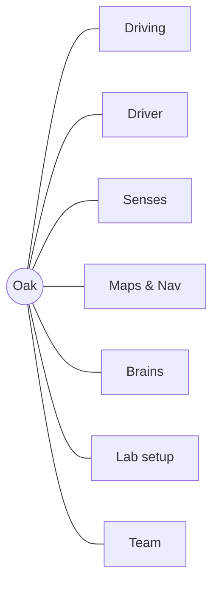

# Oak

Welcome aboard! Oak is our **Unitree Go2**, a lower-cost robot dog that normally walks wherever its hand remote tells it. We are **Team 48**, five students teaching Oak to find its own way. This repo is all of Oak's software, built with **ROS 2 Humble** (a toolkit where small programs, called *nodes*, pass data on named channels, called *topics*).

**Browse the live wiki:** [maxhawksby.github.io/go2-fusion](https://maxhawksby.github.io/go2-fusion/) - the map of every page, who is working on what, and a way to ask questions. Nothing to install.

You do not need any robotics background to start. This page is the center of our wiki: read it top to bottom, follow the links that interest you, and within half an hour you can be helping. Oak grows out of the open-source [go2_ros2_sdk](https://github.com/abizovnuralem/go2_ros2_sdk) project; go there for upstream support.

## Why we're building it

Real service dogs are very expensive, and many people who need one wait a long time. A robot dog that costs about $3,000 and has computer vision could do some of that work, like guiding a blind person through a building and talking to them through earbuds.

To get there, Oak needs **autonomous mapping**: it moves on its own, with no one holding the controller, building a map as it goes. The full plan is on the [Roadmap](docs/wiki/roadmap.md).

**Our milestone now:** Oak maps and explores a room by itself.

## What Oak can do today

- Stream its camera, lidar (a spinning laser that measures distance) and joint positions to your laptop over Wi-Fi.
- Show all of it live in RViz, a 3D viewer.
- Drive from the keyboard, a gamepad, or RViz buttons, with a referee (twist_mux) deciding who is in charge.
- Spot objects like people and chairs with YOLO computer vision.

<p align="center">


</p>

## The map

Think of the wiki as a map of Oak. This page is the center; seven hubs branch off it, and each hub links to one page per program. Every page ends with how that part breaks and who to ask.



- [Driving](docs/wiki/driving.md): keyboard, gamepad, RViz panels, and twist_mux, the referee.
- [Driver](docs/wiki/driver.md): the one program that talks to the real robot, over Wi-Fi or Ethernet.
- [Senses](docs/wiki/senses.md): lidar, camera, computer vision, and TF (tracking where each body part is).
- [Maps & Nav](docs/wiki/maps-nav.md): SLAM (building a map while locating yourself on it), Nav2 (path planning), the auto mapper, map viewers.
- [Brains](docs/wiki/brains.md): the AI agent that turns sentences into actions, walking to objects, voice, and built-in moves like sit.
- [Lab setup](docs/wiki/lab-setup.md): Docker, WSL, the lab checklist, and the robot test log.
- [Team](docs/wiki/team.md): who's who, the roadmap, and the decisions behind the code.

## Get set up

**You need:** a laptop with Docker Desktop and about 16 GB of RAM. Windows users also need WSL2 (Linux inside Windows). Macs work too. You do **not** need the robot.

**Open the team wiki first.** The quickest way is the [live wiki](https://maxhawksby.github.io/go2-fusion/) in your browser. To edit pages and see your changes instantly, run it on your laptop instead. It runs outside Docker, and needs only [Node.js](https://nodejs.org/) 18+ and Python 3.8+. From the repo folder:
```shell
npm install    # once
npm run wiki   # opens http://localhost:4410 and reloads when a page changes
```

Everything else runs inside **Docker**, which packs all the software into one identical box (a *container*), so nothing gets installed on your machine.

1. **Get the code and build** (the first build takes about 15 minutes, so start it and keep reading):
   ```shell
   git clone --recursive git@github.com:maxhawksby/go2-fusion.git
   cd go2-fusion/docker
   docker compose build
   docker compose run --rm unitree_ros true   # builds every package, then exits
   ```
2. **Try a dry run.** Open a container shell and start the keyboard driver:
   ```shell
   docker compose run --rm --name oak-dry unitree_ros bash
   teleop
   ```
   In a second terminal, watch what it sends. Hold W and the forward speed appears; let go and a stop follows.
   ```shell
   docker exec -it oak-dry bash -ic 'ros2 topic echo /cmd_vel_keyboard'
   ```
3. **Meet the real Oak** in the lab, with a teammate, using the lab checklist. Ask a teammate for access details; they are never in this repo.
4. **Pick a task** from GitHub issues (see below), make a branch, and open a pull request.

Windows without WSL, Macs, memory errors, and RViz windows: see [Lab setup](docs/wiki/lab-setup.md).

## What we're working on now (week of Oct 18)

- **Auto mapper** (Luis): reliable exploration. Fixed false walls caused by floor drift, added Scan and Reset maps buttons in RViz, and made frontier search about 100x faster. Merged to `master`. *Next:* full exploration tests on Oak. See [Auto mapper](docs/wiki/auto-mapper.md).
- **AI agent** (Adib): Ollama runs a free local Qwen model in place of the paid OpenAI API, tested on Oak and in mock mode. *Next:* odometry reliability and turn accuracy. See [LLM agent](docs/wiki/llm-agent.md).
- **Oak Control dashboard** (Noah): a browser dashboard plus a ROS 2 bridge, with live sensors and object detection over WebRTC and Foxglove, voice input, robot actions, and safety limits. Noah also wrote a repeatable lab-testing guide and reviewed Piper.
- **Text-to-speech** (Jeth): Piper, a free local voice, speaking through Oak's speaker. The audio is choppy and drops the start of short clips. *Next:* fix the packet loss, then connect it to voice commands. See [Voice](docs/wiki/voice.md).
- **Computer vision and the wiki** (Max): YOLO object detection that remembers where objects are, to help map rooms. See [Object detection](docs/wiki/object-detection.md).

**Open issues from the last robot test:**

1. Retest Nav2 goals and click-to-walk in the map viewer.
2. Retest how keyboard driving feels after the teleop fixes.
3. Find what starts the lidar-to-pointcloud node and check its input topic.
4. Confirm by eye that Oak stops cleanly when a driver goes quiet.

**Tasks live as GitHub issues**, labelled `wiki:<page>` (for example `wiki:maps-nav`). Take one by assigning it to yourself. Stuck or curious? Ask in the team Discord; nobody minds a beginner question.

## Team and how we work

Max Hawksby, Luis (LuisMend12), Noah Steinberg, Adib Rouf, and Jeth. Meet everyone, and see what each person works on, on [People](docs/wiki/people.md). TODO(Max): Luis's full name, and confirm Jeth is GitHub user jevgome.

- **Branches are your sandbox.** Push whatever you like; no review needed.
- **Merging into `master`** needs one teammate's approval and green automatic checks.
- **Keep the wiki true:** if you change a program's code, update its wiki page in the same pull request.
- Test without the robot first. There is one Oak and it accepts one connection at a time.
- Never commit keys, passwords, or lab Wi-Fi details.

## Credits and license

Built on [go2_ros2_sdk](https://github.com/abizovnuralem/go2_ros2_sdk) by @abizovnuralem, using [@tfoldi](https://github.com/tfoldi)'s [go2-webrtc](https://github.com/tfoldi/go2-webrtc), with thanks to its contributors and the TheRoboVerse community. Includes Riley Francis's [ROS2-LLM-Nav](https://github.com/RileyFrancis/ROS2-LLM-Nav) and [J. Francis's COCO detector](https://github.com/jfrancis71/ros2_coco_detector).

BSD 2-clause License. See [LICENSE](LICENSE).

<!--
Sources:
- Team 48, vision, $3,000 figure, current-work list, issue labels, merge rules, wiki rule: Max's answers via coordinator, 2026-10-22 (not in repo yet)
- Humble, Docker, 5-person team: AGENTS.md intro. Robot name "Oak": docs/wiki/decisions.md, docs/wiki/mac-setup.md
- Images: original README.md "Real time Go2 Air/PRO/EDU joints sync" and "lidar point cloud" (URLs unchanged)
- Features verified working on the robot 2026-10-11 (connect, camera, RViz, lidar ~6.8 Hz, YOLO ~4.5 fps, twist_mux priority): docs/wiki/test-log.md. Gamepad (Xbox) LB test no longer required: the team uses the Oak ROS2 pad (docs/wiki/decisions.md follow-up 5). SLAM/Nav2 left out: Nav2 goal failed on old code, retest pending.
- twist_mux referee and priorities: docs/wiki/decisions.md "twist_mux priorities"
- 16 GB RAM: inferred from the docs/wiki/test-log.md build note (7.4 GB WSL ran out of memory at 16 parallel compiles). TODO(Max): confirm minimum.
- Clone, build, aliases: CONTRIBUTING.md; docker/entrypoint.sh; docker/dev_aliases.sh; docker/Dockerfile:87-89
- ~15 min first build: docs/wiki/lab-checklist.md
- Keyboard publishes only while held, then one stop: docs/wiki/keyboard-teleop.md; docs/wiki/decisions.md row 16
- Access details kept out: docs/wiki/decisions.md row 14
- Auto mapper work: git log Oct 14-19 (LuisMend12, PRs #2-#8); docs/wiki/auto-mapper.md
- TTS: origin/jeth/feat/tts (jevgome), origin/noah/tts-piper-review
- AI agent: origin/adib/feat/llm-agent ("ollama agent instead of riley gpt")
- Dashboard: origin/feat/desktop-app-prototype (Noah Steinberg; host_tools/control_dashboard, go2_dashboard_bridge, docs/DASHBOARD_LAB_GUIDE.md)
- Computer vision memory: origin/feat/yolo-map-memory (Max Hawksby)
- Current-work wording: team updates week of 2026-10-18; roles now on docs/wiki/people.md
- Open issues: docs/wiki/test-log.md "Open issues" 1-4
- Automatic checks: .github/workflows/ros_build.yaml
- Credits/license: original README.md "Thanks" and "License"; LICENSE
-->
