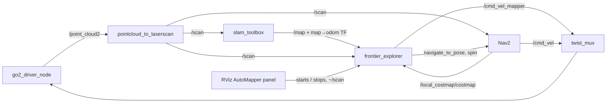

# Auto mapper: how it is built

This is the implementation guide for `go2_auto_mapper`, the node that explores a room on its own so SLAM can map it. It is for teammates who want to change the explorer or debug it.

To run it, stop it, or look up its parameters, see the package [README](../src/go2_auto_mapper/README.md).

**The explorer moves the robot by itself.** Test changes without the robot first (see [Testing](#testing)). Run it on the robot only while someone is watching.

## Where it sits in the stack



The explorer doesn't drive the motors itself, except for short recovery moves. It chooses where to go and asks Nav2 to get there, the same way a "Nav2 Goal" click in RViz does, so Nav2's planner and obstacle avoidance still apply. Its own velocity commands go to its own twist_mux input, `/cmd_vel_mapper`, at priority 6. That is above Nav2 (5) and below the keyboard (9) and joystick (10), so a person can always take over.

## Code layout

| File | What it holds | Uses ROS? |
| --- | --- | --- |
| `explorer.py` | `FrontierExplorer` node: subscriptions, the exploration loop, goal handling, maneuvers, recovery and shutdown | yes |
| `frontier_scoring.py` | Finding frontier clusters, estimating what a visit would reveal (ray casting), and tracking frontiers that a visit didn't shrink | no |
| `obstacle_sensing.py` | Reading Nav2's local costmap: free distance ahead, and whether a straight line is clear | no |
| `recovery.py` | Short backward/sideways moves: padded footprint sweep, scan coverage, scan age, and the "fresh sensing" checks | no |
| `open_space.py` | Nearest roomy spot on the SLAM map (breadth-first search plus a clearance map) | no |

Everything except `explorer.py` takes plain grids and numbers, so the tests use hand-made maps and never need ROS or the robot. Keep it that way: put new decision logic in a helper module and test it there.

## ROS interfaces

| Kind | Name | Used for |
| --- | --- | --- |
| Subscribes | `/map` (`OccupancyGrid`, transient local) | The SLAM map that frontiers and open space are found on |
| Subscribes | `/local_costmap/costmap` (`OccupancyGrid`) | What Nav2 sees right around the robot (odom frame) |
| Subscribes | `/scan` (`LaserScan`) | Live clearance for recovery moves, and sensing freshness |
| Subscribes | `/point_cloud2` (`PointCloud2`) | Sensing freshness only |
| TF | `map → base_link`, `odom → base_link` | Robot pose on the map and in the costmap |
| Action client | `/navigate_to_pose` | Exploration and escape goals |
| Action client | `/spin` | The 360° scan |
| Action client | `/backup` | Declared, but recovery now uses its own translation (see [Recovery moves](#recovery-moves)) |
| Publishes | `/cmd_vel_mapper` (`Twist`) | Recovery translations, and holding zero while waiting for fresh data |
| Service | `/frontier_explorer/scan` (`std_srvs/Trigger`) | Scan on demand (the panel's **Scan** button) |

## Timers

The node runs on two timers:

- **`exploration_loop`, every 2 s:** decides what to do next.
- **`watch_ahead`, every 0.25 s:** looks for obstacles in front of the nose. At 0.5 m/s the robot covers a meter between exploration ticks, which is too far to go without looking.

Both callbacks catch every exception and log it. An exception that escaped would stop `rclpy.spin()`, and the node would die with a Nav2 goal still active.

## Exploration loop

Each tick takes the first branch that applies, in this order:

1. **A recovery move or a latched stop is in progress:** do nothing (`watch_ahead` handles it).
2. **Waiting for fresh sensing after a recovery move:** stay stopped until it arrives (see [Fresh sensing gate](#fresh-sensing-gate)).
3. **A spin is running:** wait. If Nav2 gives no result within its time allowance plus 10 s, cancel it and latch a stop.
4. **Idle, with queued work:** back away, then scan, then escape to open space, then scan again.
5. **No map yet:** log "Waiting for map".
6. **A goal is active:** wait. A goal with no result after 60 s is cancelled in Nav2 and counts as a failure.
7. **No robot pose from SLAM yet:** log "Waiting for robot position".
8. **Otherwise:** find frontiers, check whether the last goal shrank its frontier, choose a goal, and send it.

The robot does a 360° scan at startup and after each goal it reaches. The turn gives SLAM a full lidar view, which is what places the robot on the map in the first place.

### Finding frontiers

A frontier cell is a known-free cell next to an unknown cell. `find_frontier_clusters` groups frontier cells into 4-connected clusters and drops clusters smaller than `min_frontier_size`. It is a fast version of the original per-cell code, and a test checks it gives identical output on random grids.

### Choosing a goal

`choose_frontier` builds candidate goals:

1. **Target points.** Each cluster gives its middle cell, plus one point about every meter along long clusters.
2. **Pull back from the boundary.** The goal is moved `goal_distance` (0.8 m) back toward the robot, so Nav2 isn't asked to stop on the unknown boundary, where it rejects goals.
3. **Snap to a safe cell.** The goal moves to the nearest known-free cell that is at least `wall_clearance` from a wall in the SLAM map.
4. **Drop bad candidates:** points within 0.5 m of the robot, spots that failed in the last 2 minutes (within 0.5 m), and clusters that overlap a "dead" frontier.

It then picks a goal by comparing candidates on these criteria, in order. Each criterion only breaks ties among the candidates left by the ones before it, so there is always a goal while any candidate exists:

1. **Not toward the direction the robot was just blocked in.** That is a ±45° cone, remembered for 30 s.
2. **At least `min_goal_distance` (1.5 m) away.**
3. **A clear straight line in the local costmap,** checked up to 3 m.
4. **Best information gain:** `revealed_cells − info_gain_cells_per_meter × travel_m`. The revealed cells come from `count_revealed_unknown`, which casts `info_gain_rays` rays out to `info_gain_range` and counts the unknown cells reached before a wall. Ray casting is the expensive part, so only the best tier gets it.
   - Right after a blocked goal, the longest walk on offer wins instead, so the robot gets well away from that spot.

Ranking only by distance and frontier size, as the first version did, made the robot nibble at the closest edge.

### Dead frontiers

When a goal is reached and its scan has finished, the loop waits `MAP_SETTLE_SEC` (1.5 s) for SLAM to publish, then compares the target frontier's size with its size when the goal was chosen. If it didn't shrink, the scan couldn't see into that opening, so the cluster is skipped for 2 minutes. Without this, the robot would revisit the same spot until it declared itself stuck.

Frontier cells are stored as world-coordinate keys (`world_key`) rather than grid indices, because the SLAM grid's origin moves when the map grows.

## Obstacle watch

`watch_ahead` measures the free distance in a strip as wide as the body plus 5 cm on each side, starting at the nose. When something lethal is within `obstacle_stop_distance`:

- **While driving to a goal:** after `blocked_timeout` (0 means right away), it cancels the goal, remembers the blocked heading, queues a recovery move, and asks to escape to open space.
- **While idle:** it starts a recovery move, at most once every 5 s.
- **During a spin:** nothing. Nav2's behaviors do their own collision checks.

## Recovery moves

`start_backup` replaced Nav2's BackUp action with a short translation that the explorer controls itself:

1. It tries moving back, left and right by `backup_distance` (clamped to 0.05–0.5 m). For each, it sweeps the padded footprint across the local costmap (body 0.36 m forward, 0.45 m back, 0.40 m wide, plus a 5 cm margin), and requires that live `/scan` rays actually measured that corridor as free.
2. Unknown cells, missing rays, infinite returns, and a scan older than 0.75 s all count as unsafe.
3. It picks the safe direction with the most extra clearance and drives it at 0.10 m/s on `/cmd_vel_mapper`. Every 0.25 s it checks again.
4. The move stops and latches if any of these happen:
   - it has run for 8 s;
   - the pose drifts more than 0.1 m off the line or 0.15 rad in heading;
   - the scan goes stale;
   - the corridor stops being clear.

When the robot is **latched**, it holds zero velocity and logs why. It stays stopped until one of these happens:
- a newer scan shows the way ahead is clear, or opens a corridor for another move (`latch_decision`);
- the operator presses **Scan**.

The scan that caused the stop can never release it.

### Fresh sensing gate

After a recovery move, exploration waits until there are messages newer than the stop on all of: `/scan`, `/point_cloud2`, the local costmap, and the `odom` and `map` transforms. A new SLAM `/map` is also required, but only if the robot moved at least 0.2 m, since slam_toolbox doesn't publish for shorter moves.

Each source must also be current (under 3 s old), not just newer than the stop. A source that sent one message and then died doesn't count. If everything isn't fresh within 12 s, the robot stays stopped and the log names the missing sources.

Message age uses both the header stamp and when the message arrived (`scan_age`, `stale_sources`). A message stamped more than 0.1 s in the future is treated as a clock problem and rejected.

## Escaping to open space

The robot counts as stuck when any of these happen:

- `stuck_failure_count` (3) goals fail in a row;
- a goal is abandoned for an obstacle ahead;
- two loops in a row find "No usable goal".

`start_escape` then calls `find_open_space`. It walks outward from the robot through known-free cells only (so never through walls), up to 4 m, looking for the nearest cell that is at least `open_space_clearance` (0.6 m) from anything that isn't known-free. Unknown space counts like a wall here. If nothing reaches that clearance, it takes the roomiest cell it found, as long as that is roomier than where the robot already is. The goal is at least 0.5 m away.

The escape is an ordinary `navigate_to_pose` goal, followed by a scan. Escapes are at least 30 s apart, so a failed escape can't trigger another one immediately.

## Shutdown and safety

- **Ctrl+C / SIGINT:** `stop()` publishes zero velocity and cancels the active Nav2 goal, the spin, and any orphaned maneuvers. It spins briefly, so the cancel requests actually go out before the node exits.
- **Maneuvers abandoned or timed out:** they are cancelled, and motion stays blocked until Nav2 confirms they have ended. Only a final status counts as confirmation: SUCCEEDED, CANCELED or ABORTED. A server that has been missing for 5 s counts as gone. A reply that arrives after a maneuver was abandoned is matched by a generation number, so it can't change the state of a newer maneuver.
- **Parent dies:** `stop_when_parent_dies()` asks Linux to send the explorer SIGINT when its parent process exits (`PR_SET_PDEATHSIG`). See the first item in [Known issues](#known-issues) for why this doesn't always cover RViz closing.

## RViz AutoMapper panel

`src/go2_rviz_plugins/src/auto_mapper_panel.cpp` provides:

- **Start / Stop.** Start runs `ros2 run go2_auto_mapper explorer` as a child process and shows its log in the panel. Stop sends SIGINT, so the explorer cancels its goal cleanly, and force-kills it after a timeout.
- **Scan.** Calls `/frontier_explorer/scan`. The explorer pauses the current goal (without counting it as failed), forgets recently failed spots, and turns 360°.
- **Reset maps.** Asks for confirmation, then:
  - **2D:** stops slam_toolbox with `pkill -INT`. Humble's slam_toolbox has no reset service, and the launch file respawns it with an empty map.
  - **3D:** calls `/lidar_to_pointcloud/reset` to clear the accumulated point cloud.

## Related changes in this PR

These aren't in `go2_auto_mapper`, but the explorer depends on them:

- **Lower exploration thresholds:**

  | Parameter | Old | New |
  | --- | --- | --- |
  | `min_frontier_size` | 5 | 3 |
  | `wall_clearance` | 0.5 | 0.35 |
  | `obstacle_stop_distance` | 0.3 | 0.15 |
  | `open_space_clearance` | 0.8 | 0.6 |

  With these, it explores tighter rooms instead of stopping at "No usable goal".
- **Driver stream watch** (`connection_health.StreamWatch`): it nudges the robot when the lidar or camera goes quiet while other data still arrives, and reconnects if the lidar stays quiet. Without lidar there is no `/scan`, so the explorer's sensing gate would stay closed.
- **3D map follows the environment** (`lidar_processor/point_map.py`): the accumulated cloud replaces the points in each 0.25 m cell the lidar sees again, instead of only adding to them. Moved or removed objects disappear from the 3D map.
- **RViz view follows the robot:** the layout's target frame is `base_link`.

## Testing

All the decision logic has unit tests in `src/go2_auto_mapper/test/`:

| Test file | What it covers |
| --- | --- |
| `test_frontier_scoring.py` | Information gain, walls blocking the view, world keys, dead frontiers, and the fast frontier search matching the reference |
| `test_obstacle_sensing.py` | Distance ahead and straight-line checks on the local costmap |
| `test_recovery.py` | Footprint sweeps, scan coverage, stale and future-stamped scans, the latch, and the fresh sensing gate |
| `test_refresh.py` | Every stream must be fresh after a scan; old data delivered late counts as stale; a timeout latches the stop |
| `test_open_space.py` | Nearest roomy spot, no tunneling through walls, unknown space isn't roomy, minimum move |

Run them without the robot, from `docker/`:

```shell
docker compose -f docker-compose.windows.yml run --rm unitree_ros bash -c 'python3 -m pytest /ros2_ws/src/go2_auto_mapper/test'
```

On Linux/WSL2, drop `-f docker-compose.windows.yml`.

Then check what the node publishes before giving it the robot:

- `ros2 topic echo /cmd_vel_mapper`
- `ros2 action list` (shows active `navigate_to_pose` goals)

## Known issues

- **Orphaned explorers.** The panel starts the explorer through `ros2 run`, so the explorer's parent is the `ros2 run` wrapper, not RViz. When RViz closes, the wrapper is re-parented to PID 1 and the explorer's PDEATHSIG never fires. Explorers then pile up and send competing goals. Until this is fixed, check for leftovers before starting one:

  ```shell
  ps -eo pid,ppid,args | grep '[g]o2_auto_mapper/explorer'
  ```

  Planned fix: the panel starts `<prefix>/lib/go2_auto_mapper/explorer` directly, finding the prefix with `ros2 pkg prefix`.
- **Stuck Nav2 local costmap.** On 2026-10-19, after a driver reconnect, the local costmap stopped recentering on the robot, and `controller_server` hung on a lifecycle reset. Every goal and spin then aborted with "Received plan with zero length". If the explorer keeps failing goals without moving, compare `/local_costmap/costmap_raw`'s origin with the robot's `odom` pose. Restarting the bringup clears it.
- **Fixed `odom` and `map` joints in the URDF.** `go2.urdf` declares `odom → base_link` and `map → odom` as fixed joints, so robot_state_publisher broadcasts static identity transforms. These compete with the real odometry and SLAM transforms. They came from upstream and mapping works with them, but they are a likely source of TF confusion. They should be removed.
- **Whole-map frontier scan.** Frontiers are recomputed over the entire map every 2 s, so each step gets slower as the map grows.
