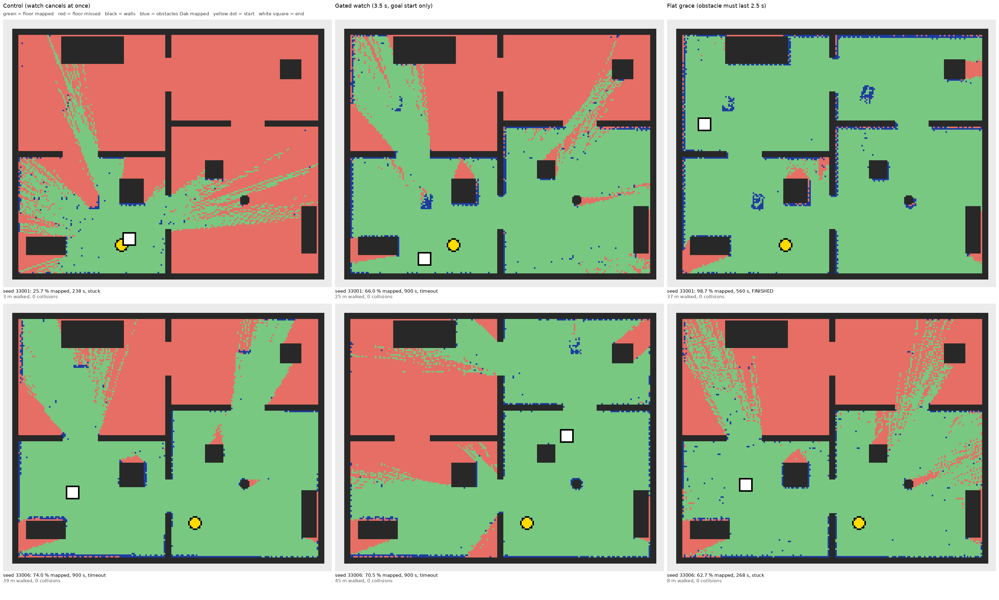
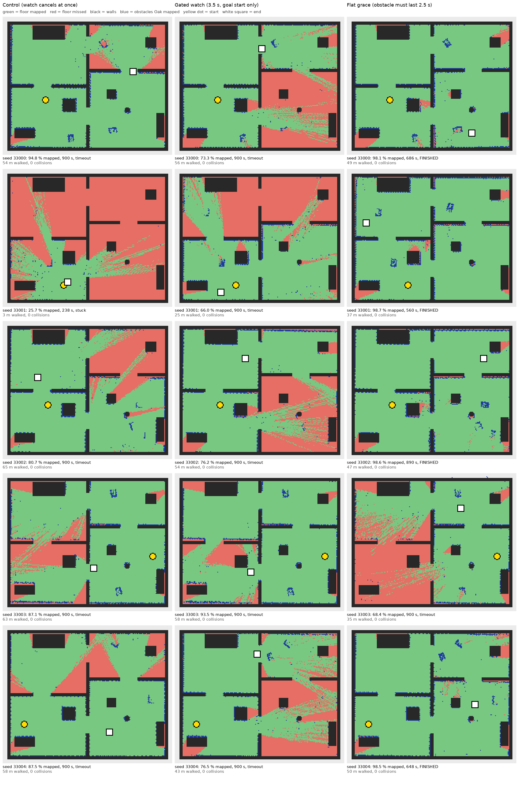
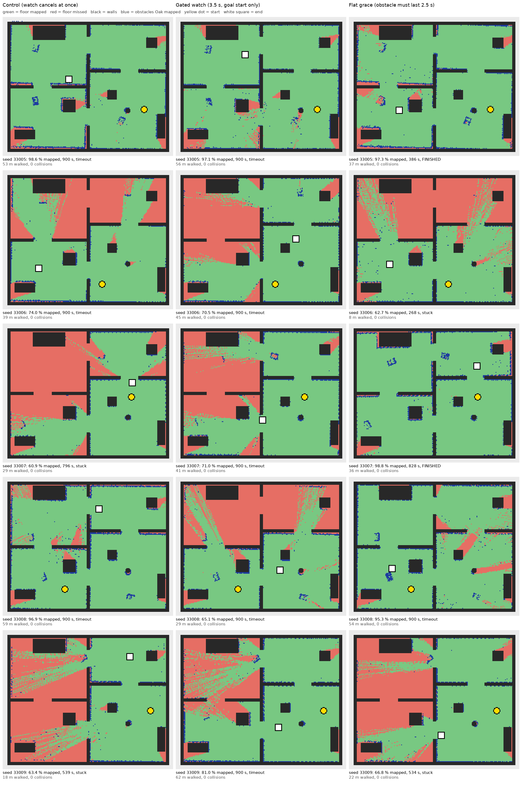

# Oak auto mapper findings, 2026-11-16

One page for the two Oak runs and the simulator batches that followed.
Discussion and day-by-day detail: issue #136 (proposal) and issue #129 (run log).

## State

- **No fix is merged.** The cause of the main failure is not found yet.
- **Do not run the auto mapper on Oak yet.** Issue #135 (recovery slides overshoot under command latency) is open, and run 2 ended in a collision (#127).
- A lab visit is still useful for measurements with no autonomy. See "Next lab visit".

## Real runs on Oak

| Run | Goals reached | Collisions | Finding |
|---|---:|---:|---|
| 1 | 0 of 6 | 0 | Oak's `/odom` carries no speed, so the DWB controller crawled under Oak's deadband (#124). Unknown cells blocked the footprint check (#125). |
| 2 | 0 of 18 | 1 | The obstacle watch cancelled all 18 goals. Oak walked into a backpack (#127). |

## Simulator batches

All use the simulator with Oak's measured limits (branch `max/exp/sim-matches-oak`), world `placeholder_rooms`, seeds 33000-33009, 10 runs, 900 s cap.

| Arm | Branch | Finished | Mean mapped | Watch cancels / goals | Batch |
|---|---|---:|---:|---:|---|
| Control (recovery-speed fix) | `max/fix/recovery-move-under-deadband` | 0/10 | 77.0 % | 194 / 327 | [43958186228](https://github.com/maxhawksby/go2-fusion/actions/runs/43958186228) |
| Gated watch, 3.5 s at goal start | `max/fix/obstacle-watch-gated` | 0/10 | 77.0 % | 180 / 328 | same |
| Flat grace, obstacle must last 2.5 s | commit `682dbdc` | 6/10 | 88.3 % | 58 / 175 | same |
| Wider Nav2 padding | `max/exp/nav2-keep-clear` | 0/10 | 77.4 % | 219 / 357 | [43972883323](https://github.com/maxhawksby/go2-fusion/actions/runs/43972883323) |
| Zero command latency | `max/exp/sim-no-latency` | 1/10 | 63.3 % | 100 / 220 | [43977103186](https://github.com/maxhawksby/go2-fusion/actions/runs/43977103186) |
| Control with cancel poses logged | `max/exp/watch-cancel-pose` | 0/10 | 76.1 % | 200 cancels | [43968354461](https://github.com/maxhawksby/go2-fusion/actions/runs/43968354461) |

Earlier 300 s batches: recovery-speed fix took runs ending stuck from 7/10 to 0/10 and mean mapped from 25.2 % to 54.6 % ([43936830662](https://github.com/maxhawksby/go2-fusion/actions/runs/43936830662)).

Per-run table for the first batch: [batch-43958186228/summary.md](batch-43958186228/summary.md).

## Map images

Final `/map` from each run over the simulator's true floor plan. Green is floor mapped, red is floor missed.

## What is established

- The obstacle watch cancels about 59 % of goals. This is the largest single loss.
- 91 % of those cancels are on real obstacles: 78 % a true wall or furniture within 0.45 m of the nose, 13 % an obstacle in the final map only (most likely the floor boxes).
- At the cancel Oak is en route, a median 3.9 m from its goal, walking at about 0.25 m/s.

## What is ruled out

| Hypothesis | Ruled out by |
|---|---|
| Cancels happen at goal start, before latency has passed | Only 32 of 194 cancels are in the first 3.5 s. Gated watch arm matched control. |
| Short-lived phantom readings | Pose logs: 9 % of cancels. |
| Goals placed too near walls | Pose logs: median 3.9 m from goal. |
| Planned path too close to walls | Wider padding arm matched control. |
| Command latency | Zero latency arm still cancelled 45 % of goals. |

## Update, 2026-11-17

Three more arms on the same seeds (33000-33009, 10 runs, 900 s). Full write-up: [#144](https://github.com/maxhawksby/go2-fusion/issues/144#issuecomment-6958807301).

| Arm | Finished | Mean mapped | Ended stuck | Collisions |
|---|---:|---:|---:|---:|
| Control | 0/10 | 77.0 % | 3 | 0 |
| Turn in place first (rotation shim) | 0/10 | 85.3 % | 0 | 0 |
| Collision monitor + turn in place | 0/10 | 54.7 % | 9 | 0 |

- **Path trace** (#142). At a cancel, Oak is a median 0.06 m off the plan from 5 s earlier, but its heading is more than 0.35 rad off in 77 % of cancels. Oak is on the path and pointing the wrong way.
- **Turn in place first** (PR #149). Kept. More map and no stuck runs. The obstacle watch still cancels 59 % of goals.
- **Collision monitor.** Dropped for now. It scales Oak's speed down near obstacles, the result falls under the 0.15 m/s walking deadband, and Oak stands still.

**Conclusion.** The conflict is physical. With a command lag of 1 s or more Oak needs 0.3 to 0.6 m of clearance at walking speed, Oak cannot walk slower than 0.15 m/s, and the test rooms need closer passes than that. The strict watch, the collision monitor and the flat grace each resolve the same conflict a different way. The simulator's lag is 1.0 s, which was chosen, not measured. Oak's true motion lag and stop distance decide which fix is safe. #141 measures them, and PR #147 reads the recordings.

Simulator experiments are paused until #141 reports.

## Open

- Oak's true motion lag and stop distance (#141). Everything else waits on this.
- The zero latency arm walked half as far. Unexplained; may be a simulator fault at zero delay.
- The flat grace finishes maps but lets Oak walk at a real obstacle for up to 2.5 s. Not safe for Oak as is.
- The simulator never reproduced the backpack hit.
- Finish rule can report "exploration complete" at 48 % (#137).

## Next lab visit (no autonomy)

From step 5 of #136. A person drives Oak; the stack only records.

1. Latency: turn Oak by hand command and compare gyro against `/odom` timing, to learn whether the 2.2-2.4 s delay is motion or late odometry.
2. Box visibility: place a backpack-sized object at 0.3, 0.5, 1.0 m and record `/point_cloud2` and `/scan` (PR #131 added the cloud to the rosbag).
3. Stop distance: walk at 0.3 m/s, command zero, measure travel.

Merge master into the branch you run so the rosbag records the cloud.
